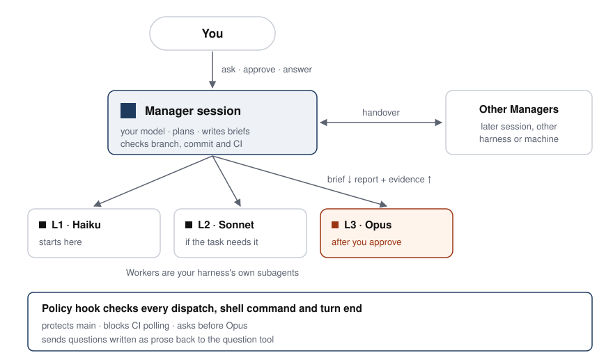

[English](README.md) | 简体中文

<p align="center">
  <picture>
    <source media="(prefers-color-scheme: dark)" srcset="docs/brand/agent-workbench-lockup-dark.svg">
    
  </picture>
</p>

# Agent Workbench

Agent Workbench 为 Codex 和 Claude Code 提供一组可移植的 skill，帮助 Manager（负责规划和验收的主会话）把工程任务分配给 Worker（执行任务的子会话），并跟踪跨会话、跨机器的交接。

## 为什么要用

让一个会话负责计划、由成本更低的会话执行任务，编码智能体通常能发挥得更好。没有规则时，智能体可能会为小任务选择最贵的模型、忘记你批准过什么，或留下没做完的分支。Agent Workbench 为你的会话提供一套工作流程：

- **主会话规划，Worker 负责实现。** 你对话的会话就是 Manager。它会拆分任务、把每部分交给 Worker subagent（子智能体），并检查结果后再告诉你任务已完成。
- **从低成本开始，需要时再升级。** L1 使用小型、快速、低成本模型处理范围明确的任务。L2 使用能力更强的通用模型，适合研究、技术试验和架构工作。L3 使用能力最强的模型，每项任务都需要你批准。Claude 默认对应 Haiku、Sonnet 和 Opus；可选的 Codex 配置将 Luna + Haiku 对应 L1、Sol + Sonnet 对应 L2、Opus 对应 L3。你也可以在 `workers.yml` 中配置网关或其他 harness 提供的模型。
- **让你快速做决定。** 智能体需要你决定时，会使用当前 harness 的提问工具，并把推荐选项放在最前面。
- **交接信息会保留下来。** Manager 会记录你的需求和已批准的事项，让后续会话或另一台机器能接着处理。

<p align="center">
  <picture>
    <source media="(prefers-color-scheme: dark)" srcset="docs/media/how-it-works-dark.svg">
    
  </picture>
</p>

功能介绍、工作原理和同类项目对比见[概览](docs/overview.md)。

这是设置完成后的真实 Claude Code 会话：Manager 把一个 bug 修复交给 Haiku Worker，之后自行检查 diff、提交和测试。


## 快速开始

1. 设置 Agent Workbench：

   ```sh
   npx @onsager/awb setup
   ```

   这会安装 skill，并应用共享全局说明和设置工具。

   

2. 如果你使用 Codex，先检查并信任它的 hook：

   ```sh
   awb trust
   ```

3. 启动新的 Manager 会话。使用 harness 自带的 subagent 工具分配工作；设置和配置说明见[参考文档](docs/reference.md)。

手动安装 skill、更新、安装到项目本地、使用 `awb prune` 清理以及详细配置，见[参考文档](docs/reference.md)。如果安装过旧版 `thermal` 启动器，或旧的 `thermal-guard`、`disk-cleanup` skill，请按[升级步骤](docs/reference.md#upgrade-to-host-ops)操作。设置过程不会安装智能体工具，也不会为 harness 完成身份验证。

使用网关或 CC Switch 的用户，可以复制[通用 Worker 配置](docs/reference.md#neutral-profile-for-provider-switching)，使用普通 Worker 名称，并遵循服务商提供的模型别名。

## 设置会修改什么

设置只会写入你的主目录，不会修改你的代码仓库。

| 路径 | 修改内容 |
| --- | --- |
| `~/.agents/skills`、`~/.claude/skills` | 下方列出的 skill |
| `~/.agents/AGENTS.md` | [共享说明](skills/workbench-setup/assets/AGENTS.md)，从 `~/.claude/CLAUDE.md` 导入，并以标记区块添加到 `~/.codex/AGENTS.md`。这些文件中你自己的文本会保留。 |
| `~/.claude/settings.json`、`~/.codex/hooks.json` | 策略 hook（见下文）和 300,000 token 的自动压缩上下文窗口 |
| `~/.claude/agents` | `haiku`、`sonnet` 和 `opus` Worker subagent |
| `~/.local/bin` | `agent-workbench` 启动器 |

安装后，策略 hook 会：

- 阻止切换到本地 `main` 或 `master` 分支，以及在这些分支上提交或推送，确保工作在任务分支上进行；
- 在派发 L3 Worker（默认是 Opus）前询问；
- 阻止轮询 GitHub，例如运行 `gh pr checks --watch` 或围绕 `gh` 使用 `sleep` 循环；
- 如果智能体在正文里提问就结束当前轮次，会让它改用提问工具。

在装有受支持传感器的 Linux 机器上，进行高负载本地工作前运行 `awb ops thermal now`，并用 `awb ops thermal gate -- <command>` 执行任务。频繁调用时，可使用已安装的 `agent-workbench ops thermal` 启动器，无需运行 `npx`。如果机器使用用户级 systemd，完成设置后可运行 `awb ops thermal install` 启用后台日志记录。

## 撤销

如果启用了可选日志记录器，请先运行 `awb ops thermal uninstall`，再移除 skill。温度日志会保留。

```sh
awb uninstall                       # 恢复说明、设置和 hook；保留你自己的修改
npx skills remove -g --all          # 移除已安装的所有全局 skill
```

若只想移除这些 skill，请明确列出名称：`npx skills remove -g manage-lane orchestrate-harnesses prompt-for-decisions host-ops workbench-setup review-storybook`。

## Skills

- **manage-lane** — 维护任务目标、授权和交接。
- **orchestrate-harnesses** — 协调原生 Worker 和 T3 Code Manager。
- **prompt-for-decisions** — 根据证据和权衡说明尚未解决的选择。
- **host-ops** — 在受支持的机器上限制高 CPU 负载，并检查或释放本地磁盘空间。
- **workbench-setup** — 应用共享全局说明，同时保留个人文本。
- **review-storybook** 为可选项。

## 许可证

MIT。详见 [LICENSE](LICENSE)。
