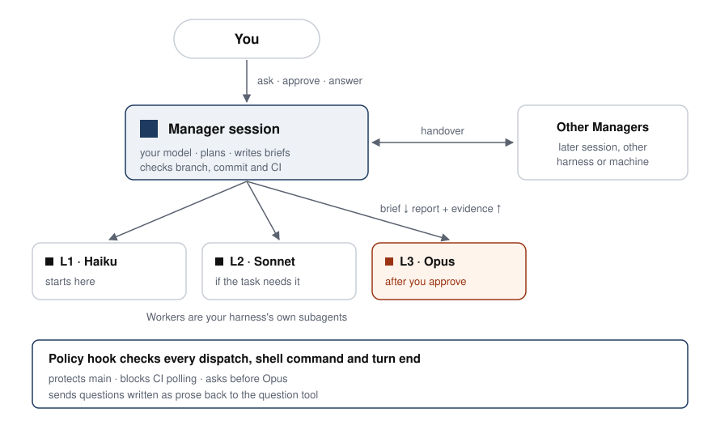
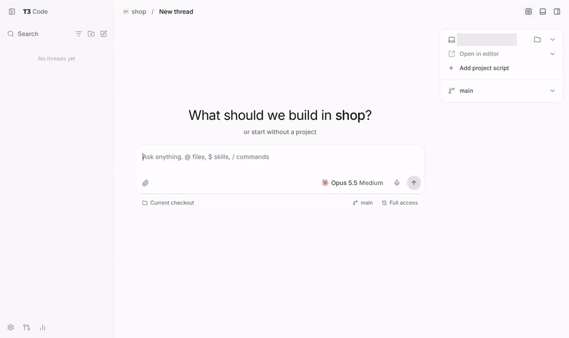
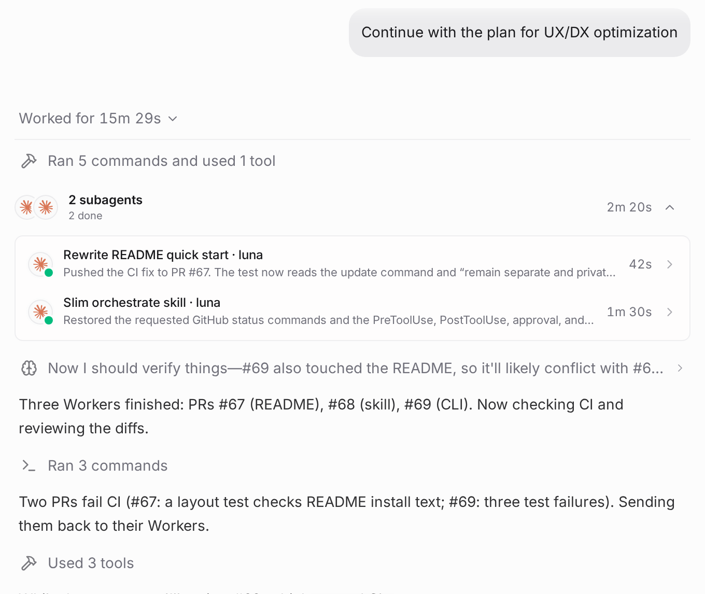

# Agent Workbench overview

Agent Workbench turns the coding agent you already use, Claude Code or Codex, into a small team. The session you talk to plans the work and checks it. Cheaper subagents do the building. A few hooks keep the agent from doing the expensive or risky things it tends to do on its own.

It installs with one command and adds no app, server or dashboard:

```sh
npx @onsager/awb setup
```

## What you get

**Lower model bills without thinking about it.** Workers start on Haiku and move to Sonnet only when the task calls for it, and the Manager has to record why. Opus runs only after you approve it for that task, and a hook enforces that rule. You can add Codex models (Luna, Sol) or your own company's models as extra tiers.

**Work you can trust when it says "done".** The Manager writes each Worker a brief, reviews what comes back, and reports the branch, commit and CI result it actually checked. Workers are told not to start their own sub-agents, and a hook warns when a Worker ran on a different model than the one requested.

**Fewer interruptions you have to decode.** When the agent needs your decision, it asks through your harness's question tool, with its recommended option first. If it ends a turn with a question buried in prose, the Stop hook sends it back to ask properly.

**No accidents on `main`.** The policy hook blocks checking out, committing to or pushing a local `main` or `master`, so every change starts on a task branch from `origin/main`.

**Wait for CI notifications.** The hook blocks GitHub polling, `while` or `until` loops with `sleep`, and `for` loops with both `sleep` and `gh`. Claude Code Managers delegate CI log retrieval to Workers.

**Tasks that survive a new session.** The Manager keeps what you asked for, what you approved and which task owns what. A later session can pick the task up from a handover note without repeating actions. With T3 Code, so can a session in another harness or on another machine.

**See active work.** `awb lanes` shows your open PRs and local worktrees without changing either.

**Cleanup after itself.** `awb prune` removes local worktrees and branches whose PRs merged, plus empty branches left by Workers.

**Easy to try and easy to undo.** Setup writes only to your home directory and keeps your own instructions and hooks. `awb uninstall` restores them.

## How it works

<picture>
  <source media="(prefers-color-scheme: dark)" srcset="media/how-it-works-dark.svg">
  
</picture>

1. **The session you talk to is the Manager.** It uses the model you picked. Small questions and routine edits it handles itself.
2. **Substantial work goes to Workers.** Workers are your harness's built-in subagents (`haiku`, `sonnet`, `opus` in Claude Code), so they inherit its permissions and sandbox. Independent pieces run in parallel.
3. **The Worker ladder picks the model.** It starts at the lowest level that fits the task kind. Moving up needs evidence of the reason, and L3 needs your approval. After two failed rework rounds the Manager comes back to you instead of trying again.
4. **The Manager verifies before reporting.** It uses the Worker’s report and final `Outcome` line to verify the branch, commit and CI result.
5. **A policy hook backs up the rules.** It runs on subagent dispatch, shell commands, T3 delegation and turn end in Claude Code, and on the same events in Codex after you run `awb trust`.

It is plain Markdown skills plus one Node script for the hook. It never writes into your repositories, so it works next to whatever a repo already commits in `AGENTS.md` or `.claude/`.

Model tiers, efforts, timeouts and optional cost caps live in one YAML file, and you can override them per user or per work directory. See the [reference](reference.md).

### In T3 Code

The same request in T3 Code, run in a throwaway project after setup. The Manager hands the fix to a Haiku Worker, which shows up as its own agent in the thread. The Manager then reruns the tests and reports the branch, commit and diff (shown at 6x speed).



From the maintainer's own Manager thread on November 20, unedited apart from cropping to the chat column. Two Luna Workers report back on PRs #67 and #68, and the Manager then checks CI on all three PRs and sends the two that failed back to their Workers.



## How it compares

Most tools in this space do one of three things: run many agents side by side, ship a large catalog of prompts, or teach a development method. Agent Workbench is a thin rules layer for one Manager session and its native subagents.

| Project | What it is | Picks cheaper models for you | Enforced by hooks | Cross-session handover | Extra app or server |
| --- | --- | --- | --- | --- | --- |
| **Agent Workbench** | Manager/Worker rules, model ladder and policy hook for Claude Code and Codex | Yes, ladder with Opus approval | Yes: Opus approval, `main` protection, no polling, question format | Yes | No |
| [Superpowers](https://github.com/obra/Superpowers) | Skills that teach a process: brainstorm, plan, TDD, review | No | No policy hooks | No | No |
| [wshobson/agents](https://github.com/wshobson/agents) | Catalog of about 200 agents and 185 skills, generated for many harnesses | Agents name a fixed model | Some plugins ship hooks | No | No |
| [Ruflo](https://github.com/ruvnet/ruflo) (formerly Claude Flow) | Swarm orchestration with many agents and MCP tools | Not described | Not described | Claims shared memory across machines | MCP server |
| [Claude Squad](https://github.com/smtg-ai/claude-squad) | Terminal UI running parallel agent sessions in worktrees | No | No | No | tmux TUI |
| Conductor, Nimbalyst, Vibe Kanban | Desktop or web apps to run and review parallel agents | No | No | No | Yes |
| Claude Code subagents and agent teams | The built-in features | You set a model per agent | Only hooks you write | No | No |

Each entry reflects the project's own README or comparison articles from November 2026 ([Augment Code](https://www.augmentcode.com/tools/open-source-agent-orchestrators), [Nimbalyst](https://nimbalyst.com/blog/best-agent-management-tools-2026/)). Check the linked project for current details.

**Where Agent Workbench fits.** It builds on Claude Code's and Codex's own subagents rather than replacing them, and adds the parts they leave to you: which model to use, when to ask you, what to block, and how to hand a task over. You can run it next to a parallel-session app such as Conductor or Claude Squad, since those manage terminals and worktrees, not model choice or approvals.

**When to pick something else.**

- You want a step-by-step method such as TDD and design review. Superpowers covers that, and Agent Workbench doesn't.
- You want ready-made specialist agents for a language or framework. Use a catalog like wshobson/agents.
- You want a visual board for many agents at once. Use one of the desktop or web apps.
- You use only Cursor, Gemini CLI or another harness. Agent Workbench supports Claude Code and Codex only.

Combining Agent Workbench with another instruction-heavy skill set is possible, but two sets of rules about delegation can contradict each other. Try them together on a small task first.
